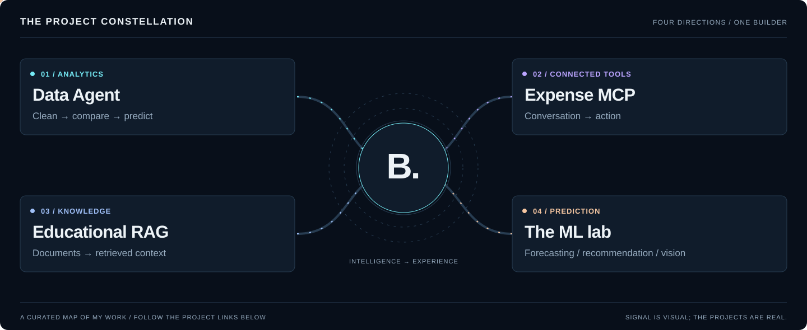
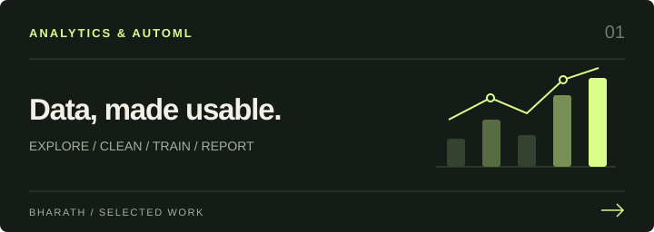
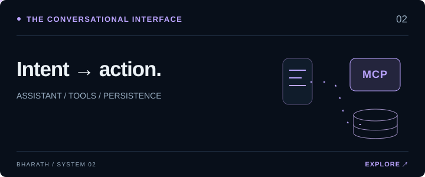
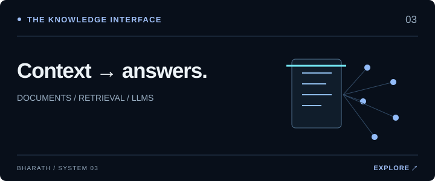
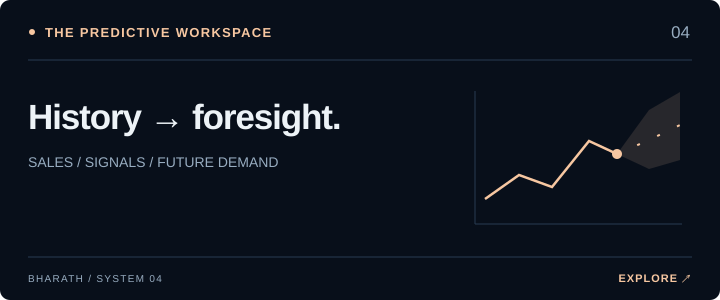
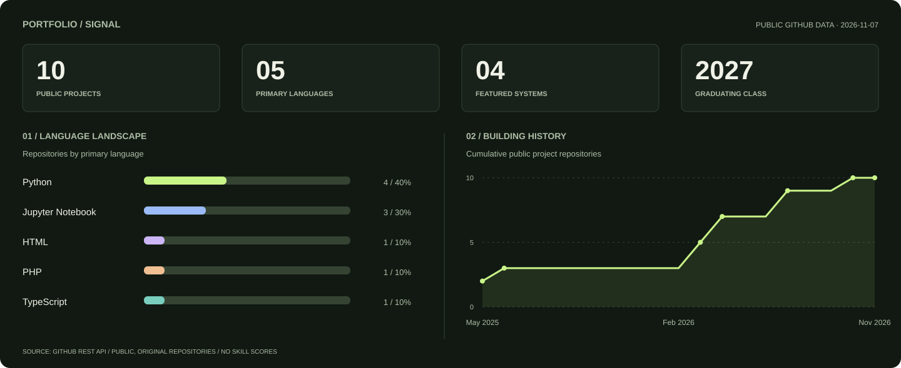
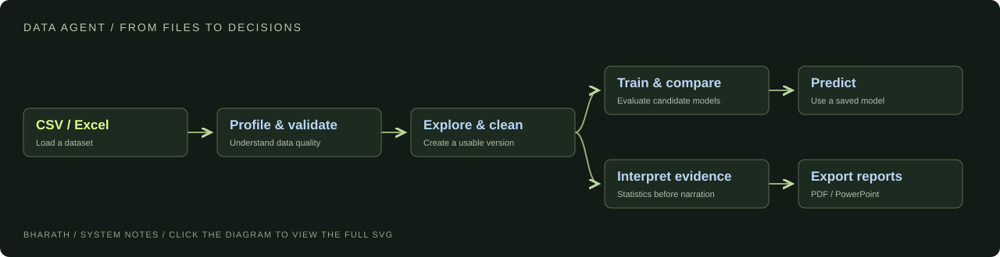
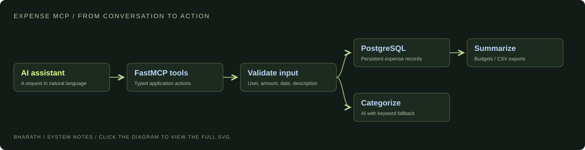

  <picture>
    <source media="(max-width: 600px)" srcset="./assets/hero-mobile.svg" />
    
  </picture>

  <a href="#the-brief"><strong>THE HUMAN</strong></a> &nbsp; / &nbsp;
  <a href="#project-constellation"><strong>THE CONSTELLATION</strong></a> &nbsp; / &nbsp;
  <a href="#selected-systems"><strong>THE BUILDS</strong></a> &nbsp; / &nbsp;
  <a href="#portfolio-signal"><strong>THE SIGNAL</strong></a> &nbsp; / &nbsp;
  <a href="#connect"><strong>CONNECT ↗</strong></a>

## The brief

**I’m Bharath Linga Reddy Palem. I build AI applications around real workflows.**

An AI/ML & Python developer in Hyderabad, studying **B.Tech AI & Data Science at ICFAI Foundation for Higher Education, Hyderabad — class of 2027**. My work connects data, models, APIs, and interfaces: from a dataset to a decision, a PDF to a grounded answer, or a conversation to an action.

<code>DATA → MODELS → TOOLS → EXPERIENCES</code>

**Open to AI/ML & Python internships.** [Start a conversation →](https://www.linkedin.com/in/bharath-linga-reddy-palem-523a6b449/)

## Project constellation

<a href="#selected-systems"><picture><source media="(max-width: 600px)" srcset="./assets/project-constellation-mobile.svg" /></picture></a>

<a href="https://github.com/BharathLingaReddy-Palem/data-agent-generative-ai">01 / Analytics ↗</a> &nbsp; · &nbsp; <a href="https://github.com/BharathLingaReddy-Palem/expense_tracker">02 / Connected tools ↗</a> &nbsp; · &nbsp; <a href="https://github.com/BharathLingaReddy-Palem/Multimodal-RAG-LoRA-Fine-Tuned-Educational-LLM">03 / Knowledge ↗</a> &nbsp; · &nbsp; <a href="https://github.com/BharathLingaReddy-Palem?tab=repositories">04 / The ML lab ↗</a>

## Selected systems

<table>
<tr>
<td width="50%" valign="top">

<h3><a href="https://github.com/BharathLingaReddy-Palem/data-agent-generative-ai">Data Agent ↗</a></h3>

<strong>The decision layer for a dataset.</strong> Explore and clean data, compare models, make predictions, and export reports from one workspace.

<code>FastAPI</code> <code>React</code> <code>scikit-learn</code>

</td>
<td width="50%" valign="top">

<h3><a href="https://github.com/BharathLingaReddy-Palem/expense_tracker">Expense Tracker MCP ↗</a></h3>

<strong>Finance tools inside a conversation.</strong> Categorize expenses, track budgets, manage reminders, and export records through MCP.

<code>FastMCP</code> <code>PostgreSQL</code> <code>NVIDIA NIM</code>

</td>
</tr>
<tr>
<td width="50%" valign="top">

<h3><a href="https://github.com/BharathLingaReddy-Palem/Multimodal-RAG-LoRA-Fine-Tuned-Educational-LLM">College PDF Intelligence ↗</a></h3>

<strong>Study material becomes a knowledge interface.</strong> Exploring PDF extraction, vector retrieval, and LoRA fine-tuning workflows.

<code>RAG</code> <code>ChromaDB</code> <code>Llama</code> <code>LoRA</code>

</td>
<td width="50%" valign="top">

<h3><a href="https://github.com/BharathLingaReddy-Palem/retail-demand-forecasting">Retail Demand Forecasting ↗</a></h3>

<strong>Better context for the next restock.</strong> Exploring demand estimation and inventory planning with historical sales and machine learning.

<code>Python</code> <code>pandas</code> <code>scikit-learn</code>

</td>
</tr>
</table>

## Portfolio signal

<a href="https://github.com/BharathLingaReddy-Palem?tab=repositories">
  <picture>
    <source media="(max-width: 600px) and (prefers-color-scheme: light)" srcset="./assets/portfolio-signal-mobile-light.svg" />
    <source media="(max-width: 600px)" srcset="./assets/portfolio-signal-mobile.svg" />
    <source media="(prefers-color-scheme: light)" srcset="./assets/portfolio-signal-light.svg" />
    
  </picture>
</a>

Real public GitHub data. The profile repository and forks are excluded. Language shares count repositories by their primary language; they are not skill ratings. Charts refresh weekly. <a href="./data/repositories.json">Data</a> · <a href="./.github/workflows/refresh-profile.yml">Refresh workflow</a>

## Inside the builds

<strong>01 / Open the Data Agent architecture</strong> — data → analysis → models → reports

### From raw files to a working analytical workflow

**Engineering choices:** versioned data cleaning, validation-based model selection, saved runs, and interfaces built around the workflow. The implementation computes statistics before requesting LLM interpretations.

[Read the implementation and its limitations →](https://github.com/BharathLingaReddy-Palem/data-agent-generative-ai)

<strong>02 / Open the Expense MCP architecture</strong> — a conversation becomes an application action

**Engineering choices:** persistent records, batch operations, recoverable expense deletion, CSV export, and a tool interface the assistant can call.

[Inspect the tools →](https://github.com/BharathLingaReddy-Palem/expense_tracker/blob/main/expense_tracker.py)

<strong>03 / Open the learning lab</strong> — retrieval, forecasting, and recommendation

| Experiment | Question I’m exploring | Repository |
| :--- | :--- | :--- |
| **Educational RAG + LoRA** | How can retrieval and adaptation help a model work with course material? | [Explore →](https://github.com/BharathLingaReddy-Palem/Multimodal-RAG-LoRA-Fine-Tuned-Educational-LLM) |
| **Retail forecasting** | How can past sales inform future inventory decisions? | [Explore →](https://github.com/BharathLingaReddy-Palem/retail-demand-forecasting) |
| **Music recommendation** | What can content similarity tell us about the next song? | [Explore →](https://github.com/BharathLingaReddy-Palem/Music-recommendation-system) |
| **Image classification** | What does it take to turn visual data into useful labels? | [Explore →](https://github.com/BharathLingaReddy-Palem/Cat_dog_classification) |

<strong>04 / Open the toolkit</strong> — the technologies behind the work

| Layer | Tools I work with |
| :--- | :--- |
| **Data & models** | Python · pandas · scikit-learn · PyTorch |
| **Language & retrieval** | RAG · ChromaDB · LoRA · LLM APIs |
| **Applications** | FastAPI · React · Streamlit |
| **Connected systems** | MCP · FastMCP · PostgreSQL · Git |

**My operating principles:** start with a real question, make the evidence visible, and finish the interface.

<strong>⌘ Open the engine room</strong> — the small generative experiment behind this profile

The header is a **3D trefoil knot**: six strands, rotated through 32 sampled orientations and projected into an animated SVG. The constellation passes light along four paths, and each project illustration uses a different motion study.

The artwork is schematic. The portfolio charts use real public repository metadata and refresh weekly. Reduced-motion preferences are supported, and the header has a separate mobile composition.

[Explore the generative artwork source →](./scripts/render_identity.py) · [Explore the chart generator →](./scripts/update_profile.py)

## Connect

I’m open to AI/ML & Python internships and conversations about practical AI applications.

&nbsp;

&nbsp;

<strong>Bharath Linga Reddy Palem</strong> · Hyderabad, India · Learn with curiosity. Build with intent.

